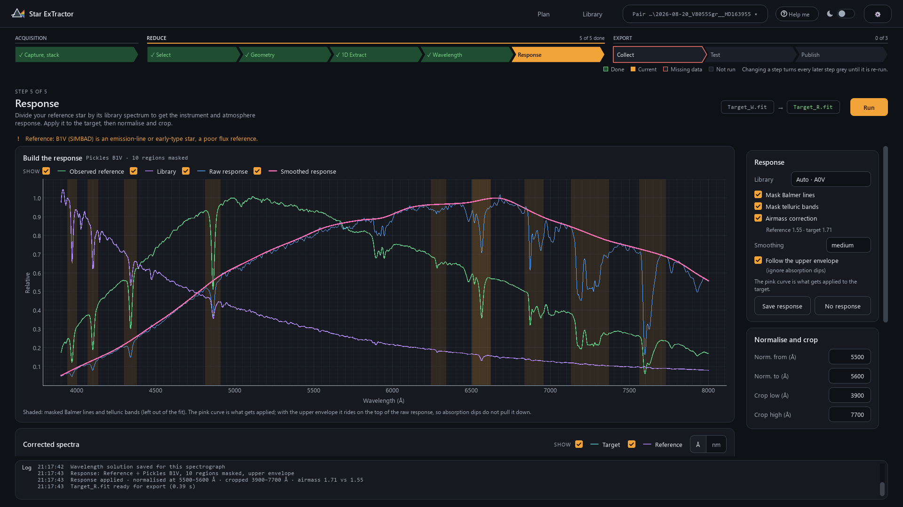
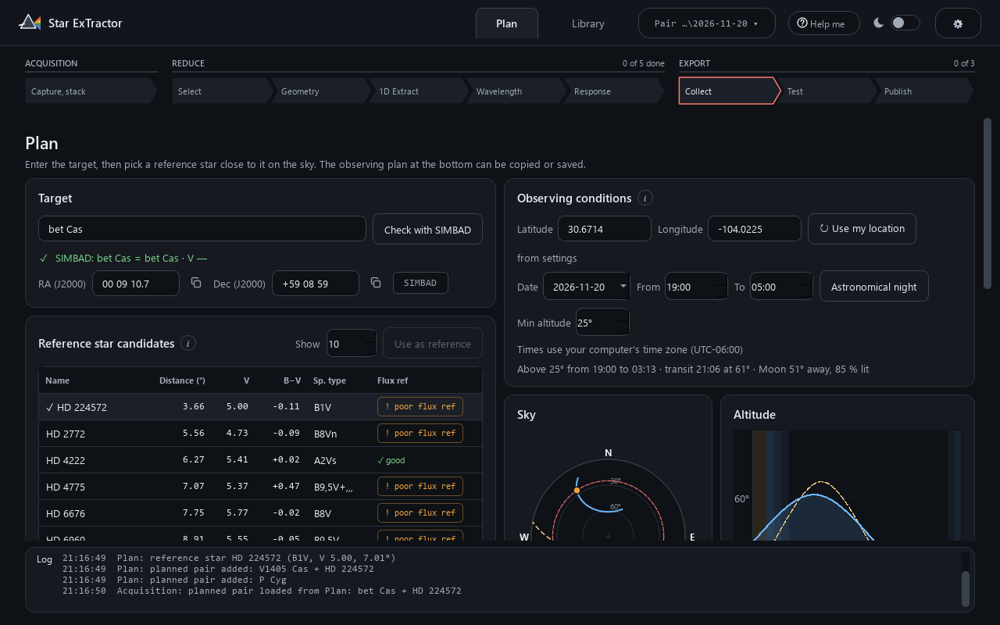
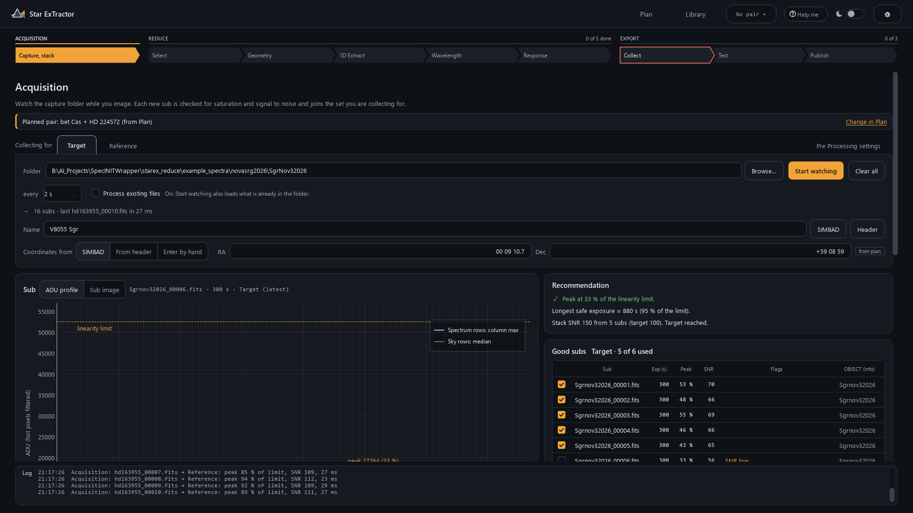
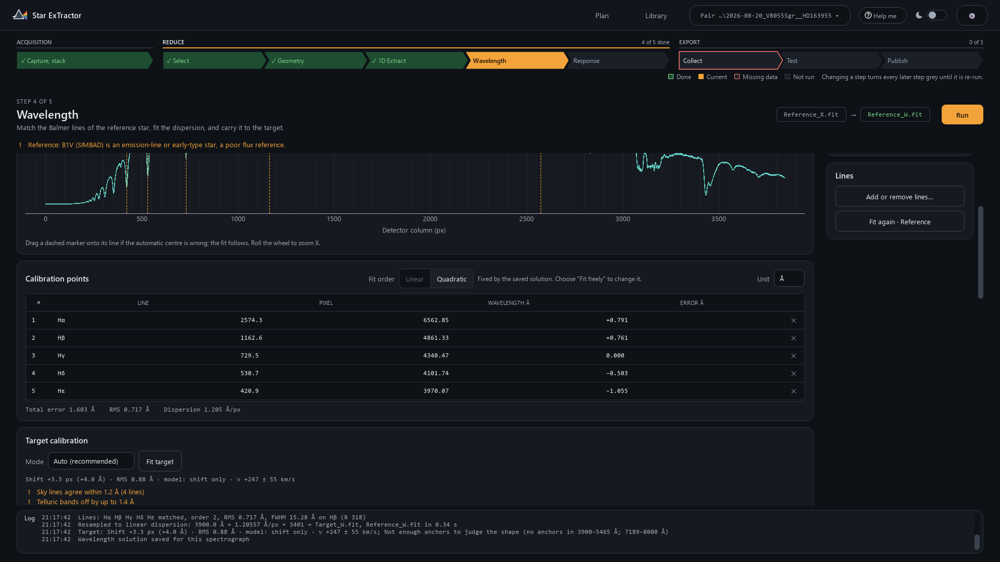
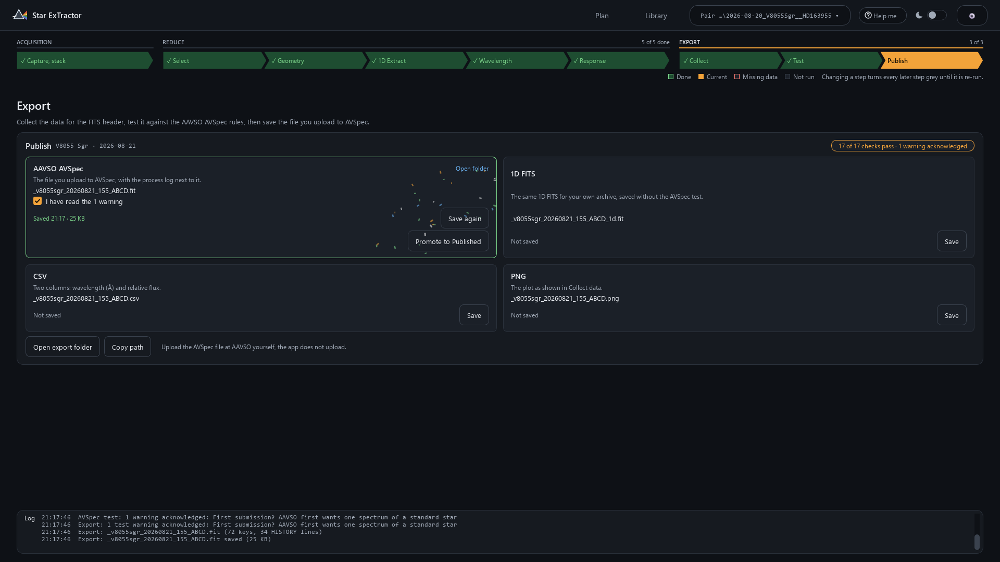
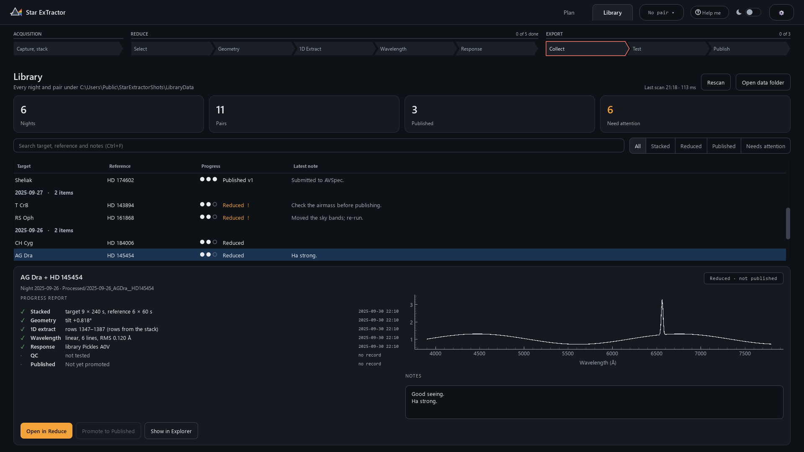
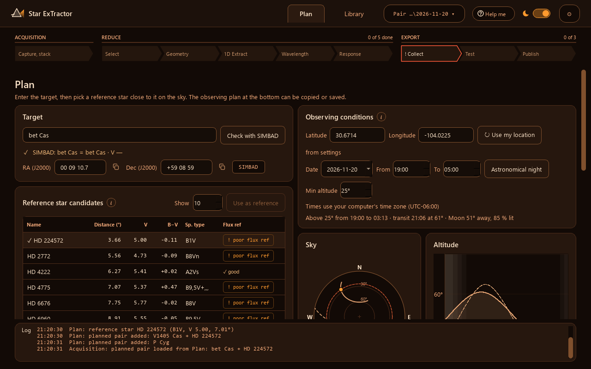

# Star ExTractor

**Version 0.1**: the first public release. Windows 10/11 (64-bit). No Python needed.

Star ExTractor turns the frames from a **Star'Ex LR** slit spectrograph into a calibrated, response-corrected 1D
spectrum, ready to upload to the **AAVSO Spectroscopy Database (AVSpec)**. It plans the night, watches your subs
while you capture, stacks them, reduces them step by step and writes the AVSpec file. Everything runs on your own
computer; nothing is uploaded for you.



**[⬇ Download the Windows installer (latest release)](https://github.com/MBoerlage/Star-ExTractor/releases/latest)**

## What it does

| | |
|---|---|
| **Plan** | Look up the target in SIMBAD (or type RA/Dec), pick a nearby reference star from our graded list of bright B and A stars, see when both are up and where the Moon is, and keep a list of target + reference pairs for the night. Copy or save the observing plan. |
| **Acquisition** | Watch the folder your capture program writes to. Every sub is checked for saturation and signal to noise as it arrives; build master darks and bias and stack the good subs. |
| **Reduce** | Select a target and reference stack, then Geometry (tilt and smile), 1D Extract, Wavelength (Balmer lines of the reference, a target-specific shift from sky and telluric lines) and Response (the reference star against a Pickles template). |
| **Export** | Collect the observer and equipment data once, run the AVSpec pre-flight checks, publish the AVSpec FITS file (plus 1D FITS, CSV and PNG if you like). |
| **Library** | Every night and pair under your data root, with progress, notes and published versions. |

Also: a **night mode** without green or blue light (and a pure-red palette), a built-in workflow guide (**Help me**,
F1), and keyboard shortcuts throughout.

| Plan | Acquisition | Wavelength |
|---|---|---|
|  |  |  |
| **Publish** | **Library** | **Night mode** |
|  |  |  |

More screenshots, with a line on each, in [`screenshots/latest/INDEX.md`](screenshots/latest/INDEX.md).

## Supported hardware

One instrument, on purpose: the **Star'Ex LR** slit spectrograph with a **ZWO ASI585MM Pro** camera. Frames from
SharpCap and N.I.N.A. (FITS, 16 bit) are read directly. Other set-ups are not supported in this version.

## Download and install

1. Open the [latest release](https://github.com/MBoerlage/Star-ExTractor/releases/latest) and download
   `StarExtractor-Setup-0.2.1.exe`. A portable zip (`StarExtractor-0.2.1-portable.zip`) is there too, for running
   without installing; `SHA256SUMS.txt` lists the checksums of both.
2. Run the installer. It installs for your user account only, so no administrator rights are needed (an
   administrator can choose "install for all users" on the first page).
3. Windows may show **"Windows protected your PC"** (Microsoft Defender SmartScreen), because the program is not
   code-signed. Click **More info**, check that the file is *StarExtractor-Setup-0.2.1.exe*, then **Run anyway**.
4. Pick a folder, optionally tick *Create a desktop shortcut*, and finish. Start it from the Start menu
   (*Star ExTractor*). At the first start it asks where to keep your data (the *data root*).

Portable zip: unzip anywhere and run `StarExtractor.exe` (SmartScreen may ask the same way).

**Update:** run the new installer over the old one; your settings and data stay. **Uninstall** from *Settings →
Apps*. The uninstaller asks whether to remove your settings as well; your data root (Stacks, Masters, Processed,
Published) is never touched.

**Check the installation:** open a command prompt in the install folder and run `StarExtractor.exe --selftest`. It
reduces a small built-in example without opening a window and prints `self-test PASSED` when all is well.

## Quick start

1. **Plan**: type the target (or check it with SIMBAD), pick a reference star from the list of nearby stars, see
   when it is up (and where the Moon is), and *Add pair* to your **planned pairs** for the night. *Load for
   acquisition* puts the names and coordinates into Acquisition; copy or save the observing plan.
2. **Acquisition**: point it at the folder your capture program saves to (the folder picker shows its FITS files
   greyed so you can check it), press *Start watching* and collect the target and reference subs. Each sub is
   checked for saturation and signal to noise while you image.
3. **Stack** in Acquisition: add darks and bias to the master library (*Pre Processing settings*) and press
   *Stack selected* for each set. Older lights: point Acquisition at their folder with *Process existing files*.
4. **Reduce**: in *Select*, press *Use Acquisition stacks* (or *Open in Reduce* on Acquisition's "Both stacks are ready"
   strip, or Browse… to any two stacks) and *Load pair*. Then run *Geometry*, *1D Extract*, *Wavelength* and *Response*.
5. **Export → Collect data**: check the object name and fill in your AAVSO observer code, site and equipment (once;
   they are remembered).
6. **Export → Test**, then **Publish**: save the AVSpec file (and, if you like, the 1D FITS, CSV and PNG).
7. **Upload the AVSpec file to AAVSO yourself** on the AVSpec website. Star ExTractor never uploads anything.

**Help me** (top row, or F1) opens the full workflow guide inside the app, with a contents list and search.

**No telescope at hand?** Create a small synthetic example night and walk through all the steps with it: press
*Win+R* and run

```
"%LOCALAPPDATA%\Programs\Star ExTractor\StarExtractor.exe" --make-example "%USERPROFILE%\Documents\StarExtractor example"
```

(use your install folder if you chose another one). It writes `target`, `reference`, `darks` and `bias` folders.

## Privacy and network

* The app goes online **only when you click**: a SIMBAD/Sesame name lookup, one VSX lookup in Export, and *Use my
  location* in Plan (an approximate position from your internet address). Everything else works offline. Nothing
  runs in the background against any server, and nothing is ever uploaded for you.
* Your observer code, site and equipment stay in your settings and go only into the files you export.
* The planning location (Plan › Observing conditions) stays in your settings and is never written to a data file or
  the observing plan. Times use your computer's time zone.

## Where your data lives

* Your **data root** (chosen at the first start, e.g. `D:\StarExtractorData`; Settings › Data locations):
  `Stacks\<night>\` (stacks and the night's sets file), `Masters\<camera>\<year>\` (calibration masters),
  `Processed\<night>_<Target>__<Ref>\` (one folder per pair: `logbook.json`, the 1D spectra, `export\`, and
  `work\`, which you may delete to save space) and `Published\<year>\<night>_<Target>_v<N>\` (the AVSpec files you
  promoted, with `submission.json`). See [`docs/DATA_ARCHITECTURE.md`](docs/DATA_ARCHITECTURE.md).
* `%APPDATA%\StarExtractor\`: settings, window state, the instrument profile, saved responses, the VSX cache and
  `error.log`. Nothing is written in the program folder.

## Troubleshooting

* **SmartScreen blocks the installer**: see *Download and install*, step 3.
* **Something went wrong**: the error window has *Open log folder*; `error.log` there has the details. Please attach
  it to a [bug report](https://github.com/MBoerlage/Star-ExTractor/issues/new/choose).
* **Start fresh**: close the app and rename `%APPDATA%\StarExtractor`; it is recreated with defaults (your data root
  is not touched).
* **The taskbar shows an old icon** after an update: Windows caches icons; it refreshes after signing out.
* **Splash screen**: turn it off in Settings › Start-up › *Show splash screen*, or for one start with
  `StarExtractor.exe --no-splash`.

## Known limitations in 0.1

* Windows only, and one instrument (Star'Ex LR + ASI585MM Pro).
* The installer is not code-signed, so SmartScreen asks once (see above).
* *Run all* (all Reduce steps in one go) is hidden in this version; run the steps one by one.
* Uploading to AVSpec is done by you on the AAVSO website.

Found a problem or have an idea? [Open an issue](https://github.com/MBoerlage/Star-ExTractor/issues/new/choose).

## For developers

Python 3.11 or newer.

```
pip install -e ".[dev]"
ruff check .
pytest -q
python -m starextractor.app            # run from source (--no-splash: without the splash)
python tools/startup_bench.py          # start-up times: splash visible, window shown, ready (median of 5)
```

Build the installer (needs `pip install -e ".[dev,build]"` and Inno Setup 6):
`powershell -ExecutionPolicy Bypass -File packaging\build.ps1`. Pushing a tag `v<version>` builds and publishes a
release on GitHub (`.github/workflows/release.yml`). See [`docs/PACKAGING.md`](docs/PACKAGING.md) and
[`CONTRIBUTING.md`](CONTRIBUTING.md). The full real example night (V8055 Sgr) used by the `realdata` tests is not in
the repository; see [`docs/EXAMPLE_NOVA.md`](docs/EXAMPLE_NOVA.md).

## Licence

MIT, see [`LICENSE`](LICENSE). Third-party data and software: [`THIRD_PARTY_NOTICES.md`](THIRD_PARTY_NOTICES.md).
Changes per version: [`CHANGELOG.md`](CHANGELOG.md).

## Credits

<!-- credits:start -->
**STAR EXTRACTOR**  
Spectroscopy reduction for low-resolution slit spectrographs

### Credits

**Stellar flux library**  
Pickles, A. J. (1998). “A Stellar Spectral Flux Library: 1150–25000 Å.”  
Publications of the Astronomical Society of the Pacific, 110, 863–878.  

**Reference star list**  
Our own selection of bright B and A dwarfs, generated from  
SIMBAD, the AAVSO VSX and the Washington Double Star Catalog  

**Spectrum submission and variable star data**  
AAVSO Spectroscopy Database (AVSpec) and Variable Star Index (VSX)  

**Target lookup**  
This application has made use of the SIMBAD database,  
operated at CDS, Strasbourg, France, and of the VizieR  
catalogue access tool, CDS, Strasbourg, France.  

**Built with**  
Python, PySide6 (Qt), NumPy, SciPy, Astropy, pyqtgraph  

**With thanks and inspiration**  
The STAROS Projects community, the AAVSO Spectroscopy SIG,  
the Society for Astronomical Sciences (SAS), the BASS Project,  
Tom Field (RSpec), the French amateur spectroscopy community,  
and many others.  

Thank you to everyone who shares their data, tools and knowledge  
with the amateur spectroscopy community – to the stars and beyond!
<!-- credits:end -->

## Acknowledgements

With thanks, and for the inspiration: the STAROS Projects community, the AAVSO Spectroscopy SIG, the Society for
Astronomical Sciences (SAS), the BASS Project, Tom Field (RSpec), the French amateur spectroscopy community, and many
others.
